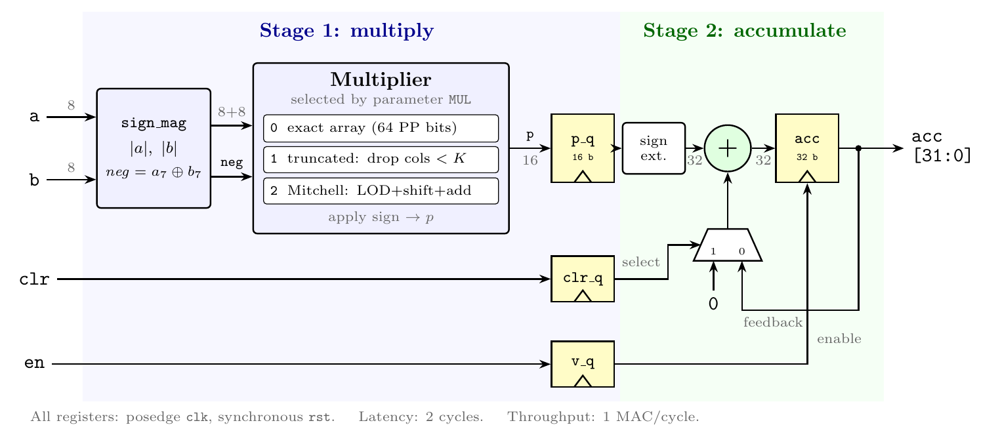
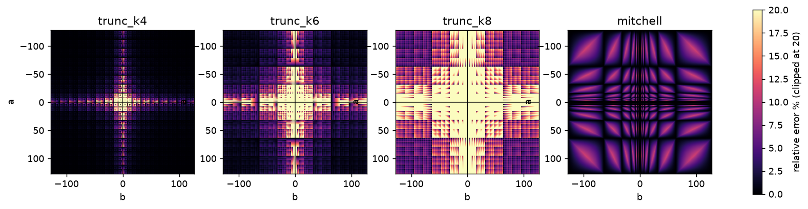
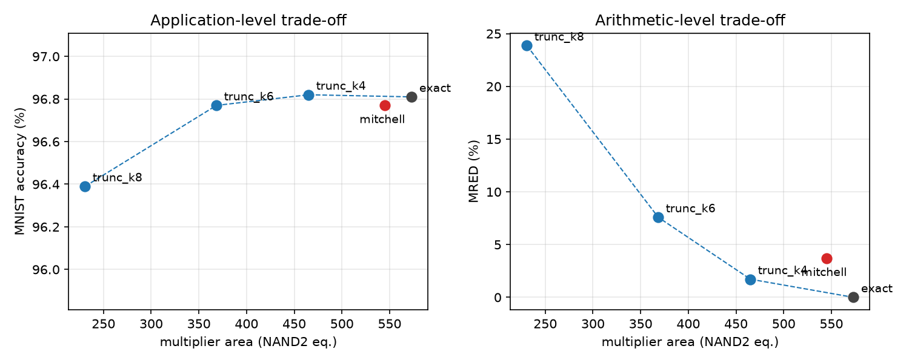
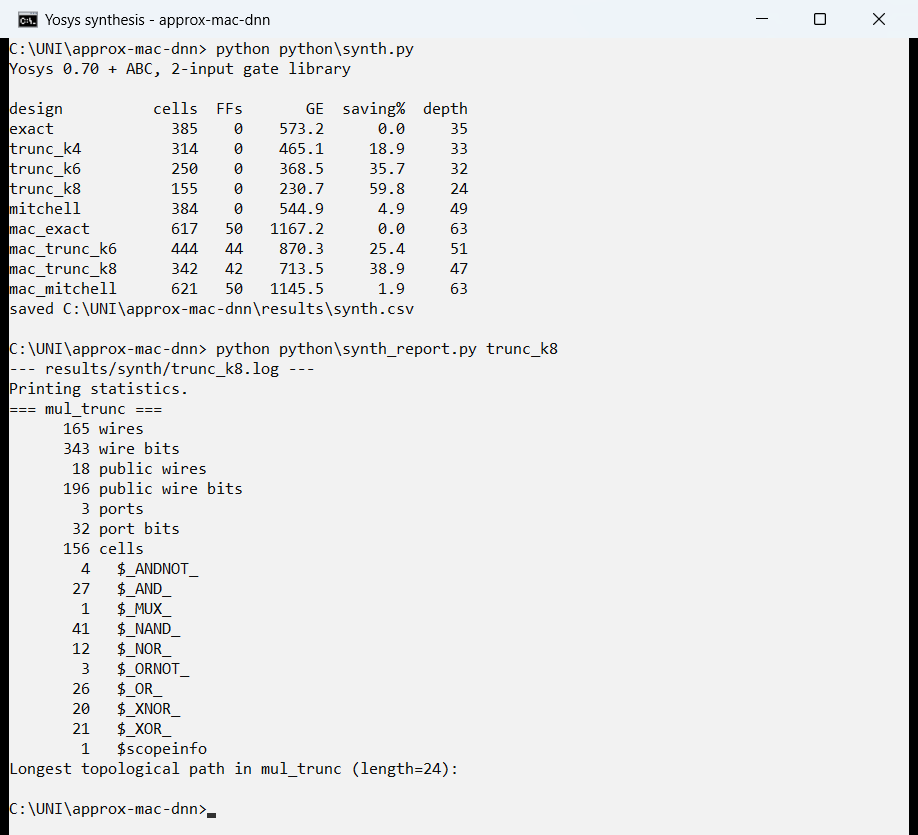
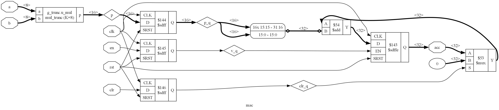
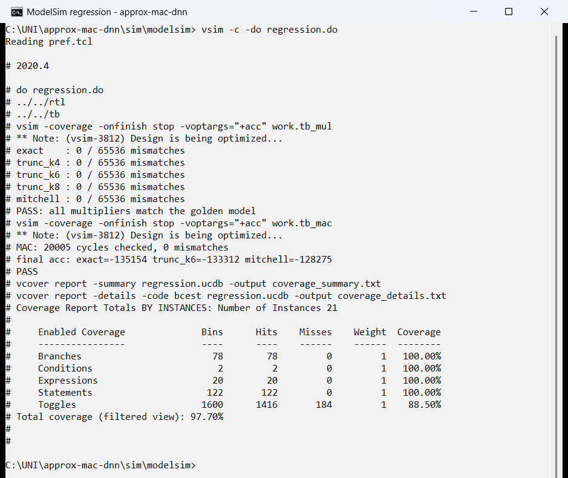
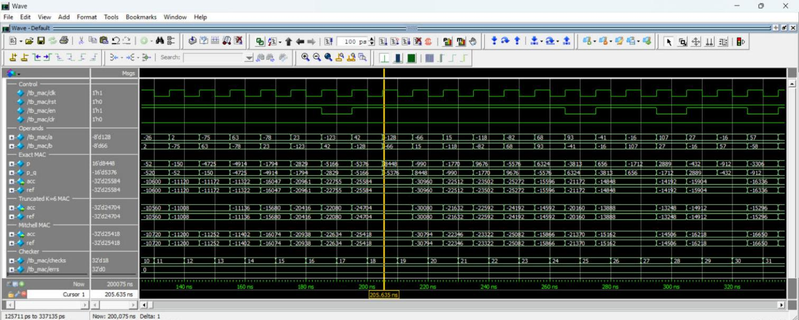
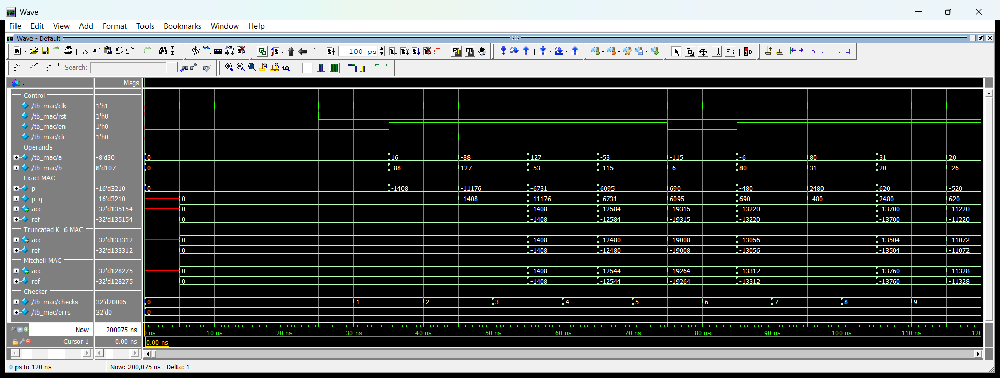

# approx-mac-dnn

Approximate multiply–accumulate (MAC) units for int8 DNN accelerators: bit-accurate
Python models, MNIST accuracy evaluation, Verilog RTL, ModelSim verification and
Yosys synthesis.

**Developed by** Sina Mozaffari Rad and Fatemeh Dastyafteh  
**Full report:** [`docs/report.pdf`](docs/report.pdf)

## Highlights

- Truncated multiplier (*K* = 8): **−59.8 % multiplier area**, **−38.9 % MAC area**, only **0.42 %** MNIST accuracy loss
- Mitchell logarithmic multiplier: saves less than 5 % at 8 bits
- All 5 multipliers verified against the Python models on all 65,536 input pairs: 0 mismatches
- 100 % statement / branch / condition / expression coverage in ModelSim

## Multipliers

| Design | Idea | Hardware |
|---|---|---|
| Exact | Sum of all 64 partial-product bits | AND array + adder tree |
| Truncated (*K* = 4, 6, 8) | Drop partial-product bits in columns below *K* | Smaller array (10 / 21 / 36 bits removed) |
| Mitchell | log₂(*ab*) ≈ *k*₁ + *k*₂ + *f*₁ + *f*₂ | 2 leading-one detectors, shifters, 1 adder |

Each multiplier plugs into the same two-stage pipelined MAC with a 32-bit accumulator.

<p align="center">
  
</p>

## Results

### Error and accuracy

| Multiplier | MRED (%) | Max error | MNIST accuracy (%) |
|---|---:|---:|---:|
| Exact | 0.00 | 0 | 96.81 |
| Truncated *K*=4 | 1.72 | 49 | 96.82 |
| Truncated *K*=6 | 7.59 | 321 | 96.77 |
| Truncated *K*=8 | 23.87 | 1537 | 96.39 |
| Mitchell | 3.70 | 1024 | 96.77 |

Float32 baseline: 96.82 %.

<p align="center">
  
</p>

### Synthesis (Yosys + ABC, 2-input gates)

| Design | Area (GE) | Saving | Logic depth |
|---|---:|---:|---:|
| Exact multiplier | 573.2 | – | 35 |
| Truncated *K*=4 | 465.1 | 18.9 % | 33 |
| Truncated *K*=6 | 368.5 | 35.7 % | 32 |
| Truncated *K*=8 | 230.7 | 59.8 % | 24 |
| Mitchell | 544.9 | 4.9 % | 49 |
| MAC, exact | 1167.2 | – | 63 |
| MAC, truncated *K*=6 | 870.3 | 25.4 % | 51 |
| MAC, truncated *K*=8 | 713.5 | 38.9 % | 47 |
| MAC, Mitchell | 1145.5 | 1.9 % | 63 |

<p align="center">
  
</p>

Logs and gate-level netlists for every design are in [`results/synth/`](results/synth).

<p align="center">
  
  <br>
  
</p>

### Verification (ModelSim)

| Testbench | Designs | Checks | Mismatches |
|---|---|---:|---:|
| `tb_mul` | exact, truncated *K*=4/6/8, Mitchell | 5 × 65,536 | 0 |
| `tb_mac` | exact, truncated *K*=6, Mitchell | 20,005 cycles | 0 |

Coverage: 100 % statements, branches, conditions and expressions; 88.5 % toggles
(the missing toggles are bits that are always constant). Full log:
[`results/modelsim_regression.log`](results/modelsim_regression.log).

<p align="center">
  
  <br>
  
</p>

Start of the run: reset is held for three cycles, then the pipeline fills and the
first products reach the accumulators.

<p align="center">
  
</p>

## Repository layout

```
rtl/            Verilog: sign_mag, mul_exact, mul_trunc, mul_mitchell, mac
tb/             self-checking testbenches
sim/modelsim/   ModelSim project and do-scripts
python/         multiplier models, error analysis, MNIST training/inference, synthesis
results/        CSV metrics, plots, synthesis logs and netlists, simulation captures
docs/           LaTeX report
```

## Getting started

Requires Python 3, ModelSim/Questa (or Icarus Verilog via `tb/run_sim.sh`) and Yosys
(`pip install yowasp-yosys` works).

```sh
pip install -r requirements.txt

python python/error_analysis.py      # error metrics + heatmaps
python python/train_quantize.py      # train and quantize the MLP
python python/approx_inference.py    # accuracy with each multiplier
python python/gen_vectors.py         # golden vectors for RTL tests
python python/synth.py               # Yosys synthesis
python python/pareto.py              # plots and summary

cd sim/modelsim
vsim -c -do regression.do            # batch regression + coverage
vsim -do gui.do                      # waveform view
```
