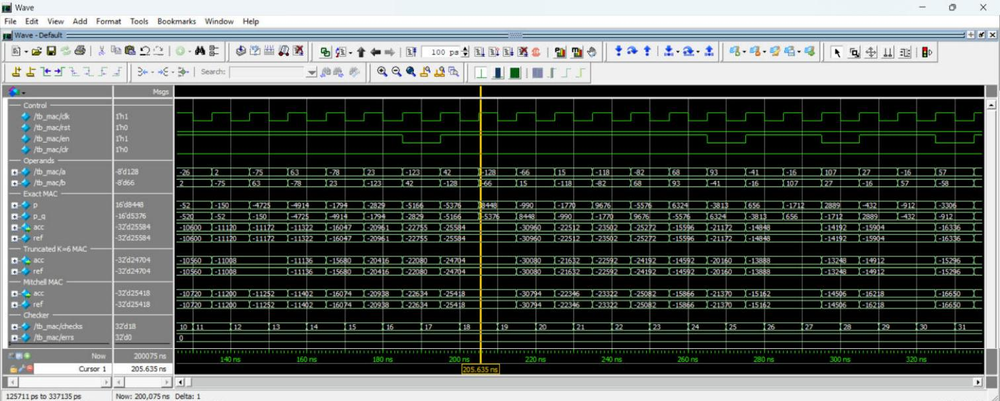

# ModelSim simulation

Scripts and project file for simulating and verifying the RTL in
ModelSim SE (tested with ModelSim SE-64 2020.4). Questa uses the same
commands.

## Files

| File | Purpose |
|---|---|
| `approx_mac.mpf` | ModelSim project with all RTL and testbench sources (relative paths) |
| `compile.do` | Creates `work`, compiles RTL with code coverage (`+cover=bcest`) and the testbenches |
| `sim_mul.do` | Exhaustive multiplier test (`tb_mul`), adds a wave view in GUI mode |
| `sim_mac.do` | Cycle-accurate MAC test (`tb_mac`) |
| `wave_mac.do` | Grouped waveform layout for `tb_mac` |
| `regression.do` | Compile, run both tests, merge coverage, write coverage reports |
| `gui.do` | Interactive session: compile, run `tb_mac` and open the wave window |

## Prerequisite

The testbenches compare against golden vectors generated by the Python
reference models:

```sh
python python/gen_vectors.py      # from the repository root
```

## Batch regression

```sh
cd sim/modelsim
vsim -c -do regression.do
```

Expected output:

```
exact    : 0 / 65536 mismatches
trunc_k4 : 0 / 65536 mismatches
trunc_k6 : 0 / 65536 mismatches
trunc_k8 : 0 / 65536 mismatches
mitchell : 0 / 65536 mismatches
PASS: all multipliers match the golden model
MAC: 20005 cycles checked, 0 mismatches
PASS
```

The merged coverage summary is written to `coverage_summary.txt` and the
per-instance details to `coverage_details.txt`.

## Interactive (GUI)

Either open `approx_mac.mpf` (File > Open > Project), compile all, and
run the scripts from the transcript, or from `sim/modelsim`:

```sh
vsim -do gui.do
```

The wave window shows control signals, operands, the product, the
stage-1 register, the accumulator and the reference model for each of
the three MAC variants:



## Coverage results

| Metric | Bins | Hit | Coverage |
|---|---|---|---|
| Statements | 122 | 122 | 100 % |
| Branches | 78 | 78 | 100 % |
| Conditions | 2 | 2 | 100 % |
| Expressions | 20 | 20 | 100 % |
| Toggles | 1600 | 1416 | 88.5 % |

All missed toggle bins are structurally unreachable rather than test
holes:

- product bits below column K of the truncated multipliers are constant 0
  by design;
- `mag[15]` can never be set, since the largest magnitude product is
  128 x 128 = 2^14;
- the upper accumulator bits are not reached by 784-term dot products of
  random int8 data;
- `a[7]` only rises once in `tb_mul` because operands are swept in order.
